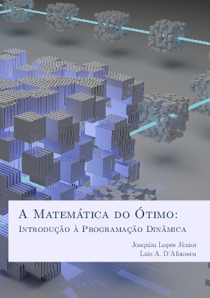

# A Matemática do Ótimo: Introdução à Programação Dinâmica

[{ width="350" }](action/A_Matematica_do_Otimo_Introducao_a_Programacao_Dinamica.pdf)

Apostila para apresentar o método de Programação Dinâmica para alunos do Ensino Médio.

## Sumário

- Introdução
- Funções REcursivas
- Máximos e Mínimos
- Gráfos e Caminhos Mínimos
- Programação Dinâmica
- Problema da Mochila
- Problema da Mochila com Repetição
- Problema de Reposição
- Considerações Finais

## Download

- __[Apostila](action/A_Matematica_do_Otimo_Introducao_a_Programacao_Dinamica.pdf)__

